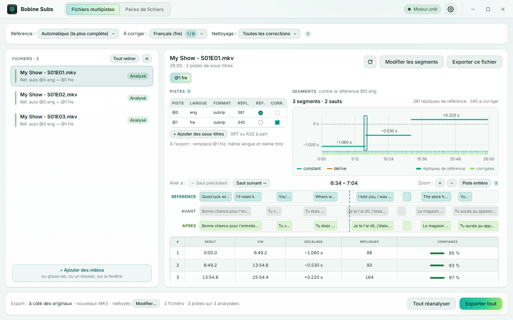
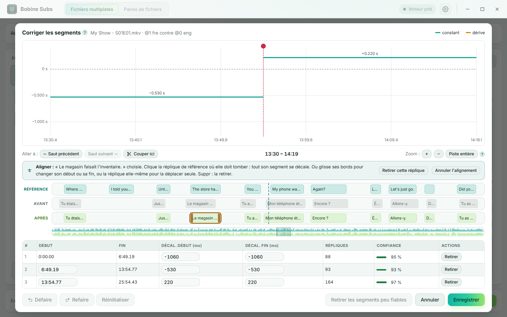
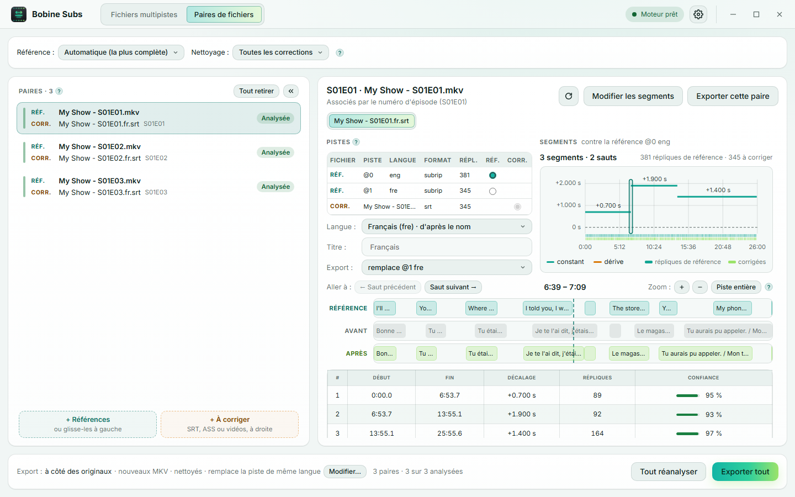

<a href="guide.md">English</a> | Français

# Guide d'utilisation

Ce guide explique comment utiliser Bobine Subs, de l'ajout des fichiers à l'export, pour un épisode comme pour une saison entière. Pour l'installation, voir le [README](../README.fr.md#installation).

## Sommaire

1. [Les mots à connaître](#les-mots-à-connaître)
2. [La fenêtre](#la-fenêtre)
3. [Fichiers multipistes, pas à pas](#fichiers-multipistes-pas-à-pas)
4. [Lire le résultat](#lire-le-résultat)
5. [Corriger les segments à la main](#corriger-les-segments-à-la-main)
6. [Les répliques retirées](#les-répliques-retirées)
7. [Le nettoyage](#le-nettoyage)
8. [Exporter](#exporter)
9. [Paires de fichiers](#paires-de-fichiers)
10. [Paramètres](#paramètres)
11. [Questions fréquentes](#questions-fréquentes)

## Les mots à connaître

- **Référence** : les sous-titres déjà bien calés sur la vidéo, en général ceux de la version originale. Ils ne sont jamais modifiés : c'est eux qui servent de repère. Leur langue n'a pas d'importance.
- **Sous-titres à corriger** : ceux qui sont décalés, par exemple une VF récupérée à part. C'est eux que Bobine Subs recale sur la référence.
- **Décalage** : l'écart entre les deux à un instant donné. **+** veut dire que les sous-titres à corriger arrivent **en retard** sur la référence, **−** qu'ils arrivent **en avance**.
- **Segment** : un morceau de la vidéo sur lequel le décalage suit une même règle. Des sous-titres décalés d'un bloc n'ont qu'un segment ; une vidéo montée différemment (coupures pub, scènes en plus ou en moins) en a plusieurs.
- **Constant, dérive, saut** :
  - *constant* : le décalage reste le même sur tout le segment ;
  - *dérive* : il grandit peu à peu, parce que les sous-titres ont été faits pour une autre cadence d'images (25 i/s au lieu de 23,976, par exemple) ;
  - *saut* : il change d'un coup entre deux segments.
- **Confiance** : la part des répliques d'un segment qui tombent bien en face de répliques de la référence, de 0 à 100 %. En dessous de 80 %, le segment est signalé **peu fiable** : à vérifier.

## La fenêtre

La barre du haut choisit l'un des deux **modes**, selon l'organisation de tes fichiers :

| Tes fichiers… | Mode |
| --- | --- |
| Chaque vidéo contient déjà les sous-titres bien calés et ceux à corriger (un MKV avec une piste anglaise et une française, par exemple) | **Fichiers multipistes** |
| Les sous-titres à corriger sont à part : des fichiers SRT ou ASS, ou les pistes d'autres vidéos | **Paires de fichiers** |

Un seul fichier marche aussi bien qu'une saison entière : les deux modes en prennent un ou plusieurs. Chaque mode garde ses fichiers quand tu passes à l'autre ; le dernier mode utilisé est repris au lancement suivant.

À droite de la barre : l'**état du moteur** (« Moteur prêt » une fois le moteur d'analyse démarré), l'icône de **mise à jour** quand une nouvelle version est sortie, et **⚙ Paramètres**.

En dessous, l'espace de travail :

- en haut, la **barre de réglages** : les pistes à utiliser et le nettoyage, pour tous les fichiers à la fois ;
- à gauche, la **liste** des fichiers. Clique sur un fichier pour l'afficher ; **↑ / ↓** passent au précédent ou au suivant. Au survol d'une ligne, ✕ la retire ; **Tout retirer** vide la liste (après confirmation, si des analyses ou des modifications seraient perdues). Le bouton **«** replie la liste en une colonne étroite, pour gagner de la place sur un petit écran ;
- à droite, le **détail** du fichier choisi ;
- en bas, le résumé des options d'**export**, l'avancement, et les boutons pour tous les fichiers à la fois.

Un seul bouton est mis en avant (en couleur) : l'étape suivante, « Analyser tout » puis « Exporter tout » (ou, avec un seul fichier, « Analyser » puis « Exporter ce fichier »).

## Fichiers multipistes, pas à pas

<picture>
  <source media="(prefers-color-scheme: dark)" srcset="screenshots/main-fr-dark.png">
  
</picture>

1. **Ajoute les vidéos** (MKV, MP4) : dépose-les sur la fenêtre, ou clique sur la zone vide. Déposer un **dossier** ajoute ses vidéos dans l'ordre des noms (« Épisode 2 » avant « Épisode 10 »). Leurs pistes sont lues aussitôt, avec le nombre de répliques de chacune.
2. **Choisis les pistes** dans la barre de réglages, pour tous les fichiers à la fois :
   - **Référence** : **Automatique (la plus complète)**, ou une piste choisie par **numéro**, **langue** ou **nom de piste**. L'automatique prend la piste qui a le plus de répliques, en laissant de côté les pistes forcées ;
   - **À corriger** : une ou plusieurs pistes, choisies de la même façon (le compteur « 1 / 6 » dit combien sont cochées).
3. **Vérifie la liste** : sous chaque nom, `Réf. auto @0 eng → @1 fre` résume ce qui sera fait (« la piste 1 recalée sur la piste 0 »). Dans le détail, le **tableau des pistes** fixe les pistes d'un fichier à la main (colonnes **Réf.** et **Corr.**) ; « Par langue » revient au choix de la barre. Une piste image (PGS des Blu-ray, VobSub des DVD) peut servir de référence, pas être recalée.
4. **Des sous-titres à part ?** « **+ Ajouter des sous-titres** », sous le tableau, ajoute un fichier SRT ou ASS comme piste à corriger de cette vidéo. Sous le tableau, « À l'export » dit ce qu'il deviendra : il **remplace** la piste de même langue de la vidéo (souvent une mauvaise), ou il est **ajouté** à côté ; la liste permet de choisir.
5. **Analyse** : « Analyser tout » analyse toutes les vidéos, l'une après l'autre ; celles qui attendent leur tour sont « En attente ». Ensuite, le bouton n'analyse que ce qui manque (nouveaux fichiers, échecs) sans perdre tes corrections ; « Tout réanalyser » recommence tout. Dans le détail d'un fichier, **⟳** réanalyse ce fichier seul.
6. **Vérifie le résultat** de chaque fichier (voir [Lire le résultat](#lire-le-résultat)), et corrige-le à la main si besoin (« Modifier les segments »).
7. **Exporte** : « Exporter tout », ou « Exporter ce fichier » dans un détail (voir [Exporter](#exporter)).

Une barre de couleur à gauche de chaque ligne et son badge disent où elle en est : à analyser, en attente, analysée, **À vérifier**, exportée, en échec. Un fichier est **À vérifier** quand un segment est peu fiable ou que des répliques seront retirées à l'export.

## Lire le résultat

Le détail d'un fichier montre, sous son nom, un bouton par **piste corrigée** (`@1 fre`) : s'il y en a plusieurs, il choisit celle affichée.

Dans une grande fenêtre, la courbe et la loupe s'affichent l'une sous l'autre ; dans une plus petite, les onglets **Segments** et **Loupe** passent de l'une à l'autre.

### Le résumé et la courbe

En tête de **Segments** : « Décalage constant de +1.200 s », ou « 3 segments · 2 sauts », une éventuelle **dérive** (« Dérive : cible accélérée (23,976 -> 25 i/s, PAL) »), et le nombre de répliques de chaque côté.

La courbe montre le décalage (verticalement) tout au long de la vidéo (horizontalement). La ligne pointillée « 0 s » correspond à la référence.

- Chaque segment est un trait : **vert** s'il est constant, **orange** s'il dérive.
- Un trait **en pointillés** est peu fiable : à vérifier dans la loupe.
- Un changement de hauteur entre deux traits est un **saut**.
- Sous la courbe, les tirets montrent où sont les répliques : celles de la référence et celles corrigées.
- Le cadre montre la partie affichée dans la loupe : clique ou glisse sur la courbe pour l'y amener.

### La loupe

Trois lignes de répliques, sur la même échelle de temps, avec leur texte :

- **Référence** : les répliques de la référence, qui ne bougent pas ;
- **Avant** : les sous-titres à corriger, tels qu'ils sont ;
- **Après** : les mêmes une fois corrigés.

Si tout va bien, chaque réplique de la ligne « Après » tombe en face de la réplique de référence qui dit la même chose. Passe la souris sur une réplique pour lire son texte complet et ses horaires. Une réplique **rouge** dans « Avant » sera retirée à l'export ; une réplique **en pointillés** sera modifiée par le nettoyage.

Pour se déplacer :

- la **molette** zoome ou dézoome sous le curseur ; **+** / **−** et « Piste entière » font de même avec des boutons ;
- **glisser** les répliques déplace la loupe dans le temps ;
- « **Aller à** : ← Saut précédent / Saut suivant → » amène la loupe sur chaque saut, le plus sûr pour vérifier les changements de segment.

### Le tableau des segments

Pour chaque segment : son début et sa fin, son décalage (du début à la fin pour une dérive), son nombre de répliques et sa **confiance**, en jauge : verte si le segment est fiable, rouge s'il est à vérifier.

### Valider un fichier

Un fichier **À vérifier** a un bouton **Valider** dans l'en-tête de son détail : une fois vérifié à l'œil, clique dessus. Il passe à **Validé** dans la liste ; un nouveau clic, ou une nouvelle analyse, l'annule.

## Corriger les segments à la main

La détection compare le rythme des répliques. Là où il ressemble à un autre passage, ou quand les deux versions diffèrent trop, elle peut se tromper. « Modifier les segments » ouvre l'éditeur pour corriger ça.

<picture>
  <source media="(prefers-color-scheme: dark)" srcset="screenshots/editor-fr-dark.png">
  
</picture>

Dans la courbe :

- **Glisse un segment** vers le haut ou le bas pour changer son décalage.
- **Glisse une poignée ●** pour déplacer la frontière entre deux segments.
- **Double-clique** pour couper un segment en deux à cet endroit ; « ✂ Couper ici » coupe au milieu de la loupe.
- La **molette** zoome, en même temps que la loupe ; **glisse le fond** pour te déplacer dans le temps. La barre sous la loupe montre tout l'épisode : glisse son cadre, ou clique pour y amener la vue.

Dans la loupe, sur une réplique de la ligne « Après » :

- **Aligner** : le plus rapide quand on voit qu'un passage est décalé. Clique la réplique, puis la réplique de référence qui dit la même chose : tout son segment se décale pour qu'elles commencent ensemble.
- **Changer son horaire seule** : une fois choisie, glisse ses bords pour changer son début ou sa fin, ou la réplique elle-même pour la déplacer. Elle se cale sur les répliques de référence proches ; garde **Alt** enfoncé pour ne pas caler.
- **La retirer** : « Retirer cette réplique », ou la touche **Suppr**.

Dans le tableau, chaque frontière (`6:49.19`) et chaque décalage peut aussi être tapé au clavier, en millisecondes, au début (« Décal. début ») et à la fin (« Décal. fin ») du segment : deux valeurs différentes en font une dérive.

- **Retirer** supprime un segment, typiquement une fausse détection : son voisin s'étend sur sa durée, avec son propre décalage. Au survol, le résultat est prévisualisé en pointillés verts sur la courbe.
- **Retirer les segments peu fiables** fait la même chose pour tous les segments peu fiables d'un coup.
- **Défaire / Refaire** (Ctrl+Z / Ctrl+Y) et **Réinitialiser** (retour à l'état d'ouverture de l'éditeur).
- **Enregistrer** garde les modifications : le résultat porte alors « Modifié à la main », et l'export les applique telles quelles. **Annuler** (ou Échap) les abandonne, après confirmation s'il y en a.

## Les répliques retirées

Certaines répliques ne sont pas exportées :

- celles d'un **passage que la référence n'a pas** (entre deux segments : une scène en plus dans cette version) ;
- celles qui tomberaient **avant le début de la vidéo** ;
- celles **retirées à la main** dans l'éditeur.

Dans le résumé, « N seront retirées » ouvre leur liste (début, texte, pourquoi). **Garder** en rattache une au segment le plus proche ; **Tout garder** les rattache toutes. Les répliques dont l'horaire a été changé à la main y figurent aussi : « Horaire d'origine » le leur rend.

Aux sauts, deux répliques qui se suivaient de près pourraient se chevaucher une fois recalées : elles se partagent alors le temps, chacune restant assez longue pour être lue, et toujours dans leur ordre d'origine.

## Le nettoyage

Les SRT récupérés ont souvent de petits défauts. À l'export, le **nettoyage** corrige les plus évidents :

- **Espaces** en trop ; **Tirets** de dialogue collés ; **Phrases collées** (« fini.Alors ») ;
- **Ponctuation** : en français, une espace insécable avant ? ! : ; (les autres langues ne sont pas touchées) ;
- **Apostrophes** droites et courbes mélangées ;
- **Publicité** : les lignes de pub d'un site de sous-titres sont retirées (le crédit du traducteur reste) ;
- **Chevauchement** : une réplique qui empiète sur la suivante ; **Trop courte** pour être lue ; **Fin avant le début**.

**Nettoyage**, dans la barre de réglages, l'active ou non pour tous les fichiers, et choisit quelles corrections il fait ; ce choix est retenu. Dans le résumé d'un fichier, « Nettoyage : Comme le lot / Oui / Non » en décide autrement pour ce fichier, suivi de ce qu'il corrigera (« 2 lignes trop courtes ») : un clic ouvre la liste des répliques modifiées, avant et après, la différence surlignée ; décoche une ligne pour la laisser telle quelle.

Seuls les SRT sont nettoyés : en ASS, styles, positions et effets sont gardés tels quels, et seuls les horaires changent.

## Exporter

**Export**, en bas à gauche, résume les options d'export ; « Modifier… » les ouvre :

- **Dossier de sortie** : **à côté des originaux** (par défaut), avec le suffixe « .synced » (`Film.mkv` donne `Film.synced.mkv`), ou **un autre dossier** (« Choisir un dossier… »), où chaque export garde le nom de son original, sauf si ce nom y est déjà pris.
- **Contenu** : **Nouveaux MKV** (la vidéo copiée telle quelle, sans réencodage, avec les pistes corrigées), ou **Sous-titres seuls** (un fichier SRT ou ASS par piste corrigée, sans toucher aux vidéos).
- **Pistes corrigées**, dans les nouveaux MKV : leur **Nom** (vide : chacune garde le sien), et si elles sont **Par défaut** ou **Forcées** : *Inchangé* garde les réglages de la piste remplacée (aucun pour une piste ajoutée), *Oui* ou *Non* les fixe.

Ces options sont retenues. Le fichier d'origine n'est jamais modifié.

Dans un nouveau MKV, une piste corrigée **remplace** la piste qu'elle corrige, à la même place, avec la même langue et le même titre. Des sous-titres ajoutés à part remplacent la piste de même langue, ou s'ajoutent, selon le choix fait dans le détail.

« Exporter tout » écrit un fichier par vidéo ; « Exporter ce fichier » n'écrit que celui affiché. « Annuler l'export » arrête celui en cours et ne lance pas les suivants : aucun fichier à moitié écrit ne reste sur le disque. Une fois un fichier écrit, l'icône de dossier dans son détail ouvre son dossier.

## Paires de fichiers

<picture>
  <source media="(prefers-color-scheme: dark)" srcset="screenshots/pairs-fr-dark.png">
  
</picture>

Chaque ligne de la liste est une **paire** : en haut la **vidéo de référence** (Réf., avec ses sous-titres bien calés), en dessous ce qu'il faut **corriger** (Corr.) : un fichier SRT ou ASS, ou une autre vidéo qui contient la piste à corriger. La piste corrigée va dans la vidéo de référence.

Tout le reste marche comme en [fichiers multipistes](#fichiers-multipistes-pas-à-pas), à ces différences près :

- **Ajouter** : « + Références » et « + À corriger » sous la liste. En déposant des fichiers, la **moitié gauche** de la fenêtre les ajoute aux références et la **moitié droite** à ce qu'il faut corriger.
- **Association** : chaque fichier rejoint son épisode d'après le **numéro dans son nom** (`S01E03`, `1x03`, `E03`, `Episode 3`…), même si les noms sont différents ; la ligne l'indique (`S01E03`). Ceux sans numéro commun sont associés dans l'ordre et signalés « ordre » (**À vérifier**). Les ↑ ↓ d'un fichier l'échangent avec celui de la paire voisine ; un fichier sans son pendant est signalé **Sans paire**.
- **Pistes** : **Référence** dans la barre, pour toutes les paires, et **À corriger** quand ce qu'il faut corriger est une vidéo. Dans le détail d'une paire, le tableau des pistes réunit celles des deux fichiers (colonne Fichier : Réf. ou Corr.) : changer un choix fixe les pistes de cette paire seulement, « Par défaut » revient à celles de la barre.
- **Langue** de la piste corrigée : devinée d'après le nom du fichier (`Film.fr.srt`, `episode-VF.srt` → français), ou celle de la piste d'une vidéo ; le détail permet d'en choisir une autre. Elle choisit aussi la typographie du nettoyage. **Titre** : le nom de la piste dans le MKV.
- **Export** : la piste corrigée **remplace** la piste de même langue de la vidéo de référence (souvent une mauvaise) ou s'ajoute à côté. Dans les options d'export, **Piste ajoutée** règle la langue et **Piste de même langue** (Remplacer / Garder) pour toutes les paires ; le détail d'une paire en décide autrement.
- En **Sous-titres seuls**, un fichier à part garde son nom (dans un autre dossier), et une piste extraite d'une vidéo prend le nom de la vidéo et sa langue (`Film.fre.srt`), que les lecteurs chargent tout seuls.

## Paramètres

Le bouton **⚙** en haut à droite ouvre les Paramètres :

- **Thème** : Système (suit le thème clair ou sombre du système), Clair ou Sombre.
- **Langue** : Système (français si le système est en français, anglais sinon), Français ou English.
- **Taille de l'interface** : 90, 100, 110 ou 125 % : textes, boutons et répliques s'agrandissent ou rapetissent ensemble. Sur un écran sans la place pour la taille choisie (un petit portable avec une grande mise à l'échelle de Windows, par exemple), l'interface est réduite pour tenir, et les Paramètres l'indiquent.
- **Mises à jour** : vérifier ou non au démarrage si une nouvelle version existe.

Quand une mise à jour est disponible, une icône apparaît à côté du ⚙ : « Installer et redémarrer » la télécharge, l'installe et relance l'application. Une analyse ou un export en cours est alors interrompu.

## Questions fréquentes

**Windows affiche « Windows a protégé votre ordinateur » à l'installation.**
L'installateur n'est pas signé par un certificat payant. Clique sur « Informations complémentaires », puis « Exécuter quand même ».

**« Démarrage du moteur… » s'affiche en haut à droite.**
Le moteur d'analyse démarre en arrière-plan, en général en une seconde ou deux. On peut déjà ajouter des fichiers : leurs pistes s'affichent dès qu'il est prêt.

**« Le moteur ne répond pas ».**
Clique sur « Réessayer ». Si ça ne suffit pas, ferme et relance l'application. Si le problème revient, un antivirus bloque peut-être le moteur (sous Windows, `syncsubtitles-engine.exe` dans le dossier d'installation).

**L'analyse ne trouve rien de bon / la confiance est basse partout.**
La référence et les sous-titres à corriger ne contiennent sans doute pas les mêmes répliques : piste forcée choisie comme référence, sous-titres d'un autre épisode, ou d'une version très différente. Vérifie dans la loupe que les répliques se ressemblent.

**Un saut est au mauvais endroit, ou un segment n'a pas lieu d'être.**
Ouvre l'éditeur : déplace la frontière, retire le segment, ou utilise « Aligner » sur une réplique du passage concerné.

**Les sous-titres ont été faits pour une autre cadence.**
C'est la dérive : elle est détectée et corrigée d'office pour les cadences classiques (23,976, 24, 25 i/s), et indiquée dans le résumé.

**Puis-je recaler des sous-titres PGS (Blu-ray) ou VobSub (DVD) ?**
Non : ils peuvent servir de référence, mais seuls les sous-titres texte (SRT, ASS) peuvent être recalés.

**Où est passée telle réplique ?**
Elle est peut-être tombée avant le début de la vidéo, ou dans une scène que la vidéo n'a pas : la liste des répliques retirées, dans le résumé, la montre avec son heure, et « Garder » la remet (voir [Les répliques retirées](#les-répliques-retirées)).

**Une réplique non dialoguée (`[Musique]`, des paroles de chanson) n'a rien en face.**
Normal : ces répliques sont ignorées pour le calage, mais recalées avec leur segment.

**La fenêtre ne tient pas sur mon écran, ou tout est trop petit / trop grand.**
Change la **Taille de l'interface** dans les Paramètres. Sur un petit écran, Bobine Subs s'ouvre déjà en plein écran et réduit l'interface pour qu'elle tienne.

**Mon fichier d'origine est-il modifié ?**
Non, jamais. L'export écrit toujours un nouveau fichier.
