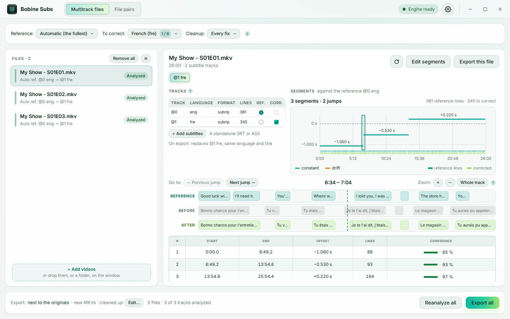
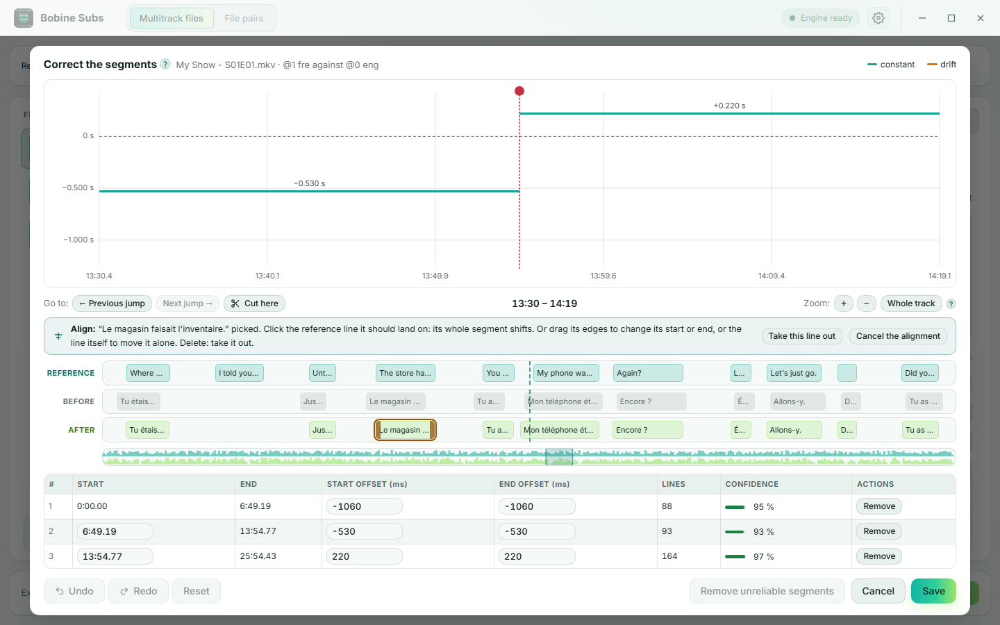
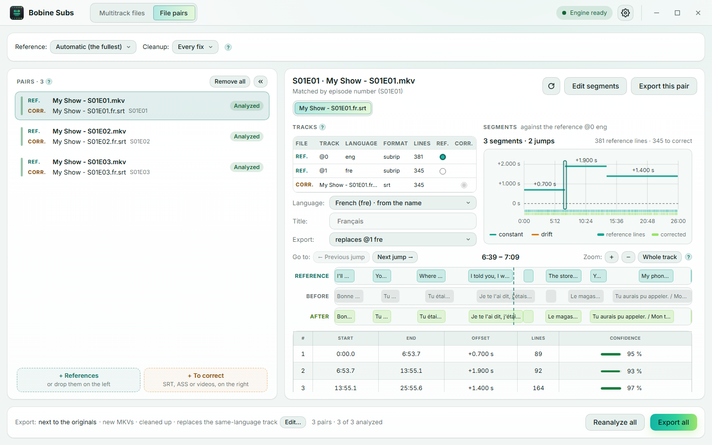

English | <a href="guide.fr.md">Français</a>

# User guide

This guide explains how to use Bobine Subs, from adding files to exporting, for one episode or a whole season. For installing it, see the [README](../README.md#install).

## Contents

1. [Words to know](#words-to-know)
2. [The window](#the-window)
3. [Multitrack files, step by step](#multitrack-files-step-by-step)
4. [Reading the result](#reading-the-result)
5. [Correcting the segments by hand](#correcting-the-segments-by-hand)
6. [Lines left out](#lines-left-out)
7. [Cleanup](#cleanup)
8. [Exporting](#exporting)
9. [File pairs](#file-pairs)
10. [Settings](#settings)
11. [FAQ](#faq)

## Words to know

- **Reference**: the subtitles already in sync with the video, usually the original version's. They're never changed: they're the benchmark. Their language doesn't matter.
- **Subtitles to correct**: the out-of-sync ones, say a French track downloaded separately. Bobine Subs retimes them onto the reference.
- **Offset**: the gap between the two at a given moment. **+** means the subtitles to correct come **late** on the reference, **−** that they come **early**.
- **Segment**: a stretch of the video over which the offset follows one rule. Subtitles off by a fixed amount have one segment; a video edited differently (ad breaks, scenes added or cut) has several.
- **Constant, drift, jump**:
  - *constant*: the offset stays the same over the whole segment;
  - *drift*: it grows little by little, because the subtitles were made for another frame rate (25 fps instead of 23.976, for instance);
  - *jump*: it changes at once between two segments.
- **Confidence**: the share of a segment's lines that land in front of reference lines, from 0 to 100 %. Under 80 %, the segment is flagged **unreliable**: worth checking.

## The window

The top bar picks one of the two **modes**, depending on how your files are organized:

| Your files… | Mode |
| --- | --- |
| Each video already holds the subtitles in sync and those to correct (an MKV with an English track and a French one, for instance) | **Multitrack files** |
| The subtitles to correct are separate: SRT or ASS files, or the tracks of other videos | **File pairs** |

One file works as well as a whole season: both modes take one or several. Each mode keeps its files when you switch to the other; the last mode used is picked up at the next launch.

On the right of the bar: the **engine status** ("Engine ready" once the analysis engine has started), the **update** icon when a new version is out, and **⚙ Settings**.

Below, the workspace:

- at the top, the **settings bar**: the tracks to use and the cleanup, for every file at once;
- on the left, the **list** of files. Click a file to show it; **↑ / ↓** go to the previous or next one. Hovering a row, ✕ removes it; **Remove all** empties the list (asking first if analyses or edits would be lost). The **«** button folds the list into a narrow column, to make room on a small screen;
- on the right, the **detail** of the chosen file;
- at the bottom, the summary of the **export** options, the progress, and the buttons for every file at once.

Only one button stands out (in color): the next step, "Analyze all" then "Export all" (or, with a single file, "Analyze" then "Export this file").

## Multitrack files, step by step

<picture>
  <source media="(prefers-color-scheme: dark)" srcset="screenshots/main-en-dark.png">
  
</picture>

1. **Add the videos** (MKV, MP4): drop them on the window, or click the empty area. Dropping a **folder** adds its videos in name order ("Episode 2" before "Episode 10"). Their tracks are read right away, with each one's number of lines.
2. **Pick the tracks** in the settings bar, for every file at once:
   - **Reference**: **Automatic (the fullest)**, or a track picked by **track number**, **language** or **track name**. Automatic takes the track with the most lines, leaving forced tracks aside;
   - **To correct**: one or several tracks, picked the same way (the "1 / 6" counter says how many are ticked).
3. **Check the list**: under each name, `Auto ref. @0 eng → @1 fre` sums up what will be done ("track 1 retimed onto track 0"). In the detail, the **tracks table** sets a file's tracks by hand (columns **Ref.** and **Corr.**); "By language" goes back to the bar's choice. An image track (Blu-ray PGS, DVD VobSub) can be a reference, not be retimed.
4. **Separate subtitles?** "**+ Add subtitles**", under the table, adds an SRT or ASS file as a track to correct of this video. Under the table, "On export" says what becomes of it: it **replaces** the video's track in the same language (often a poor one), or is **added** beside it; the list lets you choose.
5. **Analyze**: "Analyze all" analyzes every video, one after the other; those waiting their turn are "Waiting". Afterwards, the button only analyzes what's missing (new files, failures) without losing your corrections; "Reanalyze all" starts over. In a file's detail, **⟳** reanalyzes that file alone.
6. **Check the result** of each file (see [Reading the result](#reading-the-result)), and correct it by hand if needed ("Edit segments").
7. **Export**: "Export all", or "Export this file" in a detail (see [Exporting](#exporting)).

A colored bar on the left of each row and its badge say where it stands: to analyze, waiting, analyzed, **To check**, exported, failed. A file is **To check** when a segment is unreliable or lines will be left out of the export.

## Reading the result

A file's detail shows, under its name, one button per **corrected track** (`@1 fre`): if there are several, it picks the one shown.

In a large window, the curve and the loupe are shown one above the other; in a smaller one, the **Segments** and **Loupe** tabs switch between them.

### The summary and the curve

At the top of **Segments**: "Constant offset of +1.200 s", or "3 segments · 2 jumps", a **drift** if any ("Drift: target sped up (23.976 -> 25 fps, PAL)"), and the number of lines on each side.

The curve shows the offset (vertically) all along the video (horizontally). The dotted "0 s" line is the reference.

- Each segment is a line: **green** if it's constant, **orange** if it drifts.
- A **dotted** line is unreliable: check it in the loupe.
- A change of height between two lines is a **jump**.
- Under the curve, the ticks show where the lines are: the reference's and the corrected ones.
- The frame shows the part shown in the loupe: click or drag on the curve to take it there.

### The loupe

Three rows of lines, on the same time scale, with their text:

- **Reference**: the reference's lines, which don't move;
- **Before**: the subtitles to correct, as they are;
- **After**: the same once corrected.

If all is well, each line of the "After" row lands in front of the reference line that says the same thing. Hover a line to read its full text and times. A **red** line in "Before" will be left out of the export; a **dotted** one will be changed by the cleanup.

To move around:

- the **wheel** zooms in or out under the pointer; **+** / **−** and "Whole track" do the same with buttons;
- **dragging** the lines moves the loupe through time;
- "**Go to**: ← Previous jump / Next jump →" takes the loupe to each jump, the surest way to check where segments change.

### The table of segments

For each segment: its start and end, its offset (from start to end for a drift), its number of lines and its **confidence**, as a gauge: green if the segment is reliable, red if it's worth checking.

### Marking a file as checked

A file **To check** has a **Mark as checked** button in its detail's header: once you've looked it over, click it. It shows **Checked** in the list; another click, or a new analysis, undoes it.

## Correcting the segments by hand

The detection compares the rhythm of the lines. Where it looks like another stretch, or when the two versions differ too much, it can go wrong. "Edit segments" opens the editor to fix that.

<picture>
  <source media="(prefers-color-scheme: dark)" srcset="screenshots/editor-en-dark.png">
  
</picture>

In the curve:

- **Drag a segment** up or down to change its offset.
- **Drag a handle ●** to move the boundary between two segments.
- **Double-click** to cut a segment in two there; "✂ Cut here" cuts in the middle of the loupe.
- The **wheel** zooms, together with the loupe; **drag the background** to move through time. The bar under the loupe shows the whole episode: drag its frame, or click to take the view there.

In the loupe, on a line of the "After" row:

- **Align**: the quickest when a stretch is visibly off. Click the line, then the reference line that says the same thing: its whole segment shifts so that they start together.
- **Change its times alone**: once picked, drag its edges to change its start or end, or the line itself to move it. It snaps to nearby reference lines; hold **Alt** not to snap.
- **Take it out**: "Take this line out", or the **Delete** key.

In the table, each boundary (`6:49.19`) and each offset can also be typed, in milliseconds, at the start ("Start offset") and the end ("End offset") of the segment: two different values make a drift.

- **Remove** deletes a segment, typically a false detection: its neighbour stretches over its time, with its own offset. On hover, the result is previewed as green dashes on the curve.
- **Remove unreliable segments** does the same for every unreliable segment at once.
- **Undo / Redo** (Ctrl+Z / Ctrl+Y) and **Reset** (back to how the editor opened).
- **Save** keeps the changes: the result then reads "Edited by hand", and the export applies them as they are. **Cancel** (or Esc) drops them, asking first if there are any.

## Lines left out

Some lines aren't exported:

- those of a **stretch the reference lacks** (between two segments: a scene this version has more);
- those that would fall **before the start of the video**;
- those **taken out by hand** in the editor.

In the summary, "N will be removed" opens their list (start, text, why). **Keep** attaches one to the nearest segment; **Keep all** attaches them all. The lines whose times were changed by hand are listed too: "Original times" gives them back.

At jumps, two lines that followed each other closely could overlap once retimed: they then share the time, each kept long enough to be read, and always in their original order.

## Cleanup

Downloaded SRT files often have small faults. On export, the **cleanup** fixes the obvious ones:

- extra **Spaces**; stuck dialogue **Dashes**; **Sentences run together** ("done.Then");
- **Punctuation**: in French, a no-break space before ? ! : ; (other languages are left alone);
- straight and curly **Apostrophes** mixed;
- **Ad**: a subtitle site's ad lines are removed (the translator's credit stays);
- **Overlap**: a line running into the next; **Too short** to be read; **Ends before it starts**.

**Cleanup**, in the settings bar, turns it on or off for every file, and picks which fixes it makes; the choice is remembered. In a file's summary, "Cleanup: As the batch / Yes / No" decides otherwise for that file, followed by what it will fix ("2 lines too short"): a click opens the list of the lines it changes, before and after, the difference highlighted; untick a line to leave it as it is.

Only SRT files are cleaned up: in ASS, styles, positions and effects are kept as they are, and only the times change.

## Exporting

**Export**, at the bottom left, sums up the export options; "Edit…" opens them:

- **Output folder**: **next to the originals** (the default), with the ".synced" suffix (`Film.mkv` gives `Film.synced.mkv`), or **another folder** ("Choose a folder…"), where each export keeps its original's name, unless that name is already taken there.
- **Contents**: **New MKVs** (the video copied as is, without re-encoding, with the corrected tracks), or **Subtitles only** (one SRT or ASS file per corrected track, leaving the videos alone).
- **Corrected tracks**, in the new MKVs: their **Name** (empty: each keeps its own), and whether they're **Default** or **Forced**: *Unchanged* keeps the replaced track's settings (none for an added track), *Yes* or *No* sets them.

These options are remembered. The original file is never changed.

In a new MKV, a corrected track **replaces** the track it corrects, in the same place, with the same language and title. Subtitles added separately replace the track in the same language, or are added, as chosen in the detail.

"Export all" writes one file per video; "Export this file" only writes the one shown. "Cancel export" stops the current one and doesn't start the next: no half-written file is left on disk. Once a file is written, the folder icon in its detail opens its folder.

## File pairs

<picture>
  <source media="(prefers-color-scheme: dark)" srcset="screenshots/pairs-en-dark.png">
  
</picture>

Each row of the list is a **pair**: on top the **reference video** (Ref., with its subtitles in sync), below it what to **correct** (Corr.): an SRT or ASS file, or another video holding the track to correct. The corrected track goes into the reference video.

Everything else works as with [multitrack files](#multitrack-files-step-by-step), with these differences:

- **Adding**: "+ References" and "+ To correct" under the list. When dropping files, the **left half** of the window adds them to the references and the **right half** to what's to correct.
- **Matching**: each file joins its episode by the **number in its name** (`S01E03`, `1x03`, `E03`, `Episode 3`…), even if the names differ; the row shows it (`S01E03`). Those without a shared number are matched in order and flagged "order" (**To check**). A file's ↑ ↓ swap it with the neighbouring pair's; a file without its match is flagged **No pair**.
- **Tracks**: **Reference** in the bar, for every pair, and **To correct** when what's to correct is a video. In a pair's detail, the tracks table gathers both files' tracks (File column: Ref. or Corr.): changing a choice sets that pair's tracks only, "Default" goes back to the bar's.
- **Language** of the corrected track: guessed from the file name (`Film.fr.srt`, `episode-VF.srt` → French), or that of a video's track; the detail lets you pick another. It also picks the cleanup's typography. **Title**: the track's name in the MKV.
- **Export**: the corrected track **replaces** the reference video's track in the same language (often a poor one) or is added beside it. In the export options, **Added track** sets the language and **Same-language track** (Replace / Keep) for every pair; a pair's detail decides otherwise.
- With **Subtitles only**, a separate file keeps its name (in another folder), and a track taken from a video gets the video's name and its language (`Film.fre.srt`), which players load on their own.

## Settings

The **⚙** button at the top right opens the Settings:

- **Theme**: System (follows the system's light or dark theme), Light or Dark.
- **Language**: System (French if the system is in French, English otherwise), Français or English.
- **Interface size**: 90, 100, 110 or 125 %: text, buttons and lines grow or shrink together. On a screen without room for the chosen size (a small laptop with a large Windows scaling, for instance), the interface is shrunk to fit, and the Settings say so.
- **Updates**: whether to check at startup for a new version.

When an update is available, an icon appears next to the ⚙: "Install and restart" downloads it, installs it and relaunches the app. An analysis or export in progress is then interrupted.

## FAQ

**Windows shows "Windows protected your PC" when installing.**
The installer isn't signed with a paid certificate. Click "More info", then "Run anyway".

**"Starting the engine…" shows at the top right.**
The analysis engine starts in the background, usually in a second or two. You can already add files: their tracks show as soon as it's ready.

**"The engine isn't responding".**
Click "Retry". If that's not enough, close and relaunch the app. If it happens again, an antivirus may be blocking the engine (on Windows, `syncsubtitles-engine.exe` in the install folder).

**The analysis finds nothing good / the confidence is low everywhere.**
The reference and the subtitles to correct probably don't hold the same lines: a forced track picked as reference, subtitles of another episode, or of a very different version. Check in the loupe that the lines look alike.

**A jump is in the wrong place, or a segment shouldn't be there.**
Open the editor: move the boundary, remove the segment, or use "Align" on a line of that stretch.

**The subtitles were made for another frame rate.**
That's drift: it's detected and corrected on its own for the usual rates (23.976, 24, 25 fps), and shown in the summary.

**Can I retime PGS (Blu-ray) or VobSub (DVD) subtitles?**
No: they can be a reference, but only text subtitles (SRT, ASS) can be retimed.

**Where did this line go?**
It may have fallen before the start of the video, or in a scene the video doesn't have: the list of lines left out, in the summary, shows it with its time, and "Keep" puts it back (see [Lines left out](#lines-left-out)).

**A line that isn't dialogue (`[Music]`, song lyrics) has nothing in front of it.**
That's expected: such lines are ignored for the sync, but retimed with their segment.

**The window doesn't fit my screen, or everything is too small / too big.**
Change the **Interface size** in the Settings. On a small screen, Bobine Subs already opens maximized and shrinks the interface to fit.

**Is my original file changed?**
No, never. The export always writes a new file.
